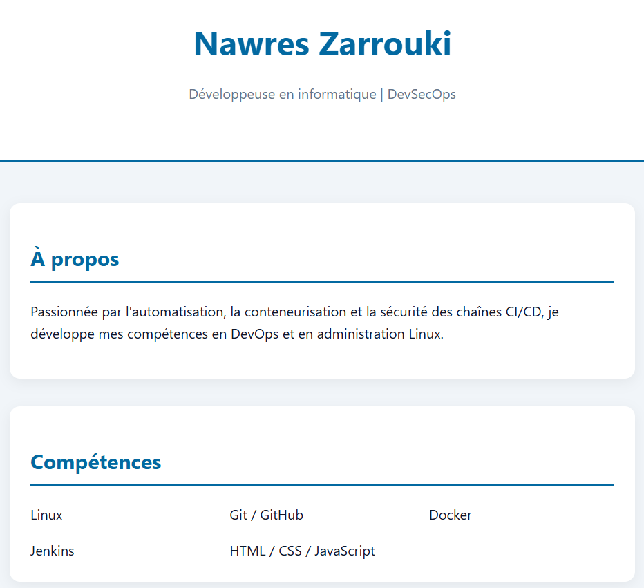
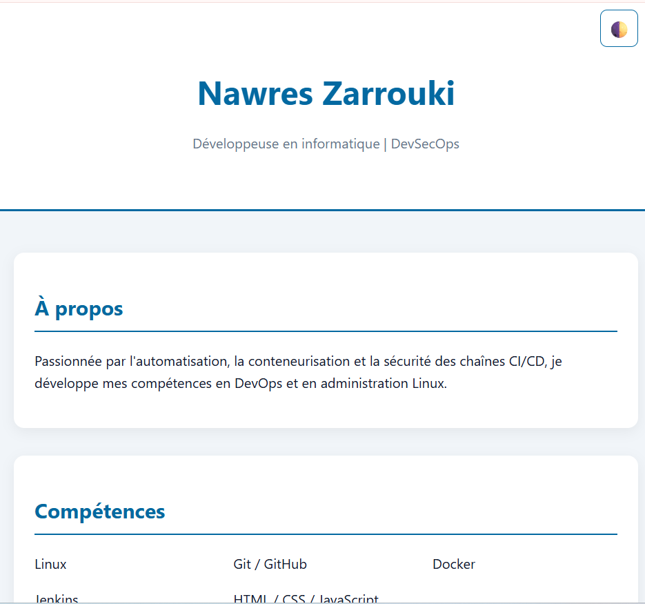
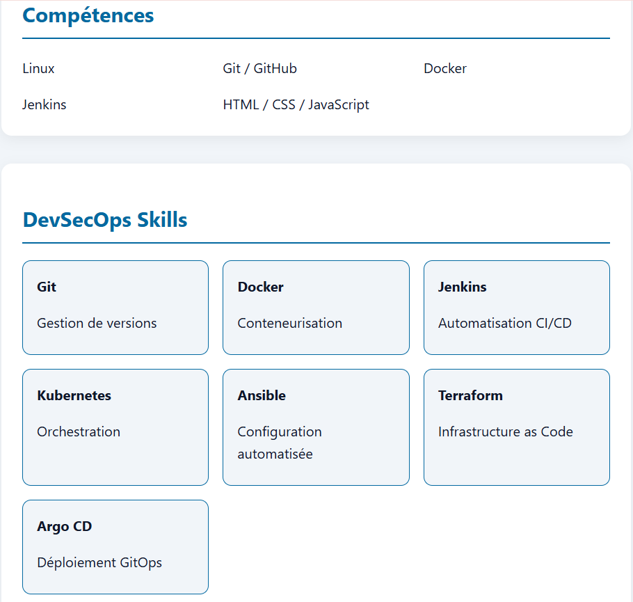
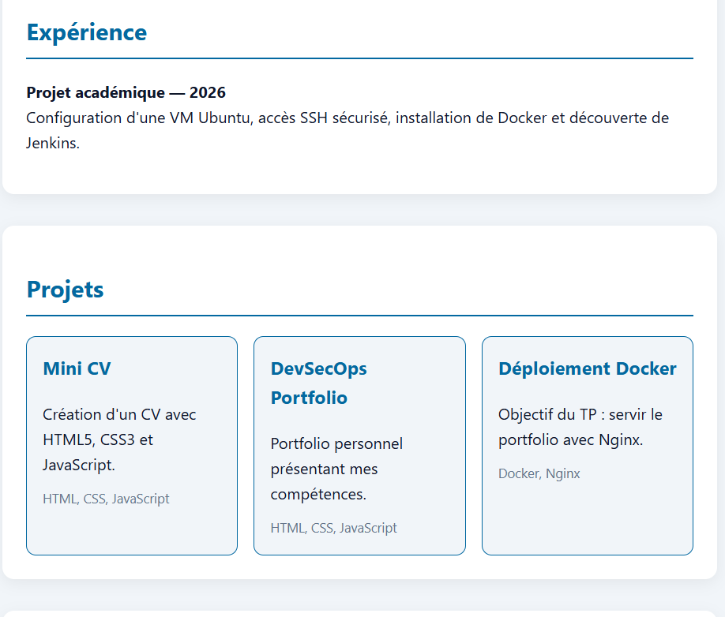
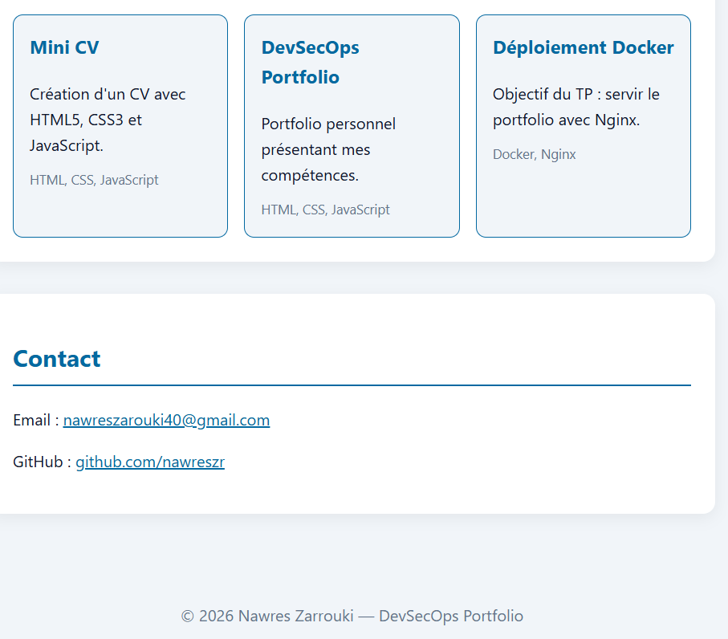
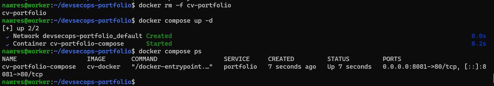

# DevSecOps Portfolio

## Présentation

Portfolio personnel réalisé dans le cadre d’un TP DevSecOps. Il présente mon profil, mes compétences techniques et mes projets, et documente la conteneurisation du site web.

## Objectifs

- Développer un portfolio responsive.
- Présenter les compétences et les projets dynamiquement.
- Ajouter un changement de thème.
- Construire une image Docker avec Nginx.
- Déployer le site avec Docker et Docker Compose.
- Versionner le projet avec Git et GitHub.

## Technologies utilisées

- HTML5
- CSS3
- JavaScript
- Docker
- Nginx
- Docker Compose
- Git et GitHub

## Structure du projet

```text
devsecops-portfolio/
├── index.html
├── style.css
├── script.js
├── Dockerfile
├── compose.yaml
├── README.md
└── captures/
```

## Déploiement Docker

Construire l’image :

```bash
docker build -t cv-docker .
```

Lancer le conteneur :

```bash
docker run -d --name cv-portfolio -p 8081:80 cv-docker
```

Vérifier le conteneur :

```bash
docker ps
```

Tester le site :

```bash
curl -I http://localhost:8081
```

## Déploiement avec Docker Compose

Lancer le service :

```bash
docker compose up -d
```

Vérifier son état :

```bash
docker compose ps
```

Arrêter le service :

```bash
docker compose down
```

## Captures d’écran

Place les captures dans le dossier `captures/` à la racine du projet.

### 1. Portfolio



### 2. Dockerfile



### 3. Construction de l’image Docker



### 4. Conteneur Docker



### 5. Docker Compose



### 6. Dépôt GitHub


*Remarque : les captures doivent être ajoutées dans le dossier `captures/` avec les noms indiqués pour apparaître dans ce README.*
## Captures d'écran

### Portfolio


### Dockerfile


### Construction de l'image Docker


### Conteneur Docker


### Docker Compose


### État des services Docker Compose

## Dépôt GitHub

[Consulter le dépôt du projet](https://github.com/nawreszr/devsecops-portfolio)

## Auteur

**Nawres Zarrouki**

GitHub : [@nawreszr](https://github.com/nawreszr)

E-mail : nawreszarouki40@gmail.com
